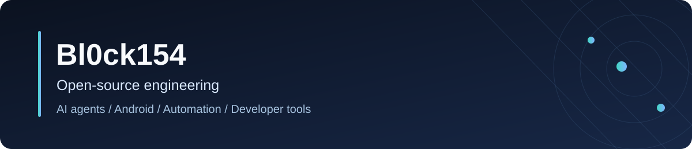
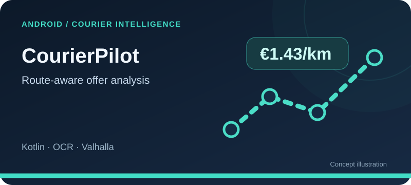
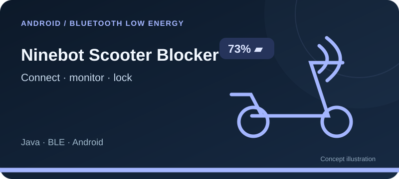
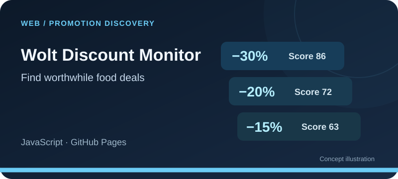
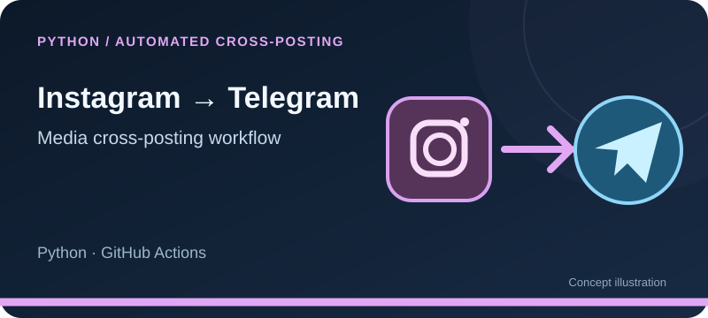
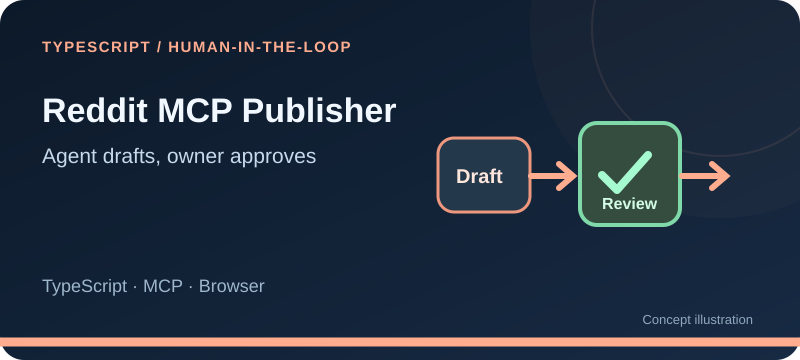

# Hi, I'm Illia 👋

**I build open-source tools for AI agents, Android, browser automation, and everyday workflows.**

[Projects](#featured-open-source-projects) · [Developer tools](#tools-for-developers) · [Contributions](#upstream-contributions)

I work across Android apps, Go services, Python automation, browser extensions and tools for AI coding agents. My public projects include installable Android APKs, a live web dashboard and self-hosted integrations. Each repository documents its setup and limits.

## Featured open-source projects

Original project illustrations below. Each card opens the source repository.

| | |
| :---: | :---: |
|  |  |
| **[CourierPilot](https://github.com/Bl0ck154/CourierPilot)** Android offer analysis, routing and private courier statistics. [Download APK](https://github.com/Bl0ck154/CourierPilot/releases/latest) | **[Ninebot Scooter Blocker](https://github.com/Bl0ck154/Ninebot-scooter-blocker)** BLE telemetry, auto-reconnect, charging alerts and software lock. [Download APK](https://github.com/Bl0ck154/Ninebot-scooter-blocker/releases/latest) |
|  |  |
| **[InstaFix Revived](https://github.com/Bl0ck154/InstaFix-Revived)** Self-hosted Go service for better Instagram previews in chat apps. [Self-hosting guide](https://github.com/Bl0ck154/InstaFix-Revived#run-your-own-instance) | **[Wolt Discount Monitor](https://github.com/Bl0ck154/wolt-discount-monitor)** Search and compare visible food-delivery promotions. [Open public dashboard](https://bl0ck154.github.io/wolt-discount-monitor/) |
|  |  |
| **[Instagram → Telegram](https://github.com/Bl0ck154/instagram-to-telegram)** Scheduled cross-posting without running your own server. [Setup guide](https://github.com/Bl0ck154/instagram-to-telegram#quick-start) | **[Reddit MCP Publisher](https://github.com/Bl0ck154/reddit-mcp-publisher)** Agent-assisted reading, draft previews and owner-approved posting. [Workflow guide](https://github.com/Bl0ck154/reddit-mcp-publisher#see-the-workflow) |

[**Engineering case studies →**](PROJECTS.md) — technical decisions, constraints and implementation details behind the projects.

## Tools for developers

- [**Website Image Finder Skill**](https://github.com/Bl0ck154/website-image-finder-skill) — an agent skill for finding, reviewing and optimizing web images.
- [**SellerPilot for Etsy**](https://github.com/Bl0ck154/sellerpilot-for-etsy) — browser extension improving Etsy seller messaging and offering context-aware AI assistance.
- [**Gemini Watermark Remover Light**](https://github.com/Bl0ck154/gemini-watermark-remover-light) — local browser image tool and experimental video workflow.
- [**ApKilla**](https://github.com/Bl0ck154/ApKilla) — Android Quick Settings utility for force-stopping an app through Accessibility.
- [**TrustedHousesitters Sit Monitor**](https://github.com/Bl0ck154/trustedhousesitters-sit-monitor) — unofficial, self-hosted listing monitor with Telegram notifications.

## Upstream contributions

I also maintain forks and contribute fixes to other open-source projects. You can explore my [public contributions](https://github.com/pulls?q=is%3Apr+author%3ABl0ck154) and [repositories](https://github.com/Bl0ck154?tab=repositories).

## Get involved

Found a bug or have an idea? Open an issue in the relevant repository. Each project has its own setup instructions and compatibility limits. Stars help others discover the work, but actionable feedback and reproducible bug reports are especially useful.

Independent open-source projects. Third-party product names are used to describe compatibility, not affiliation.
